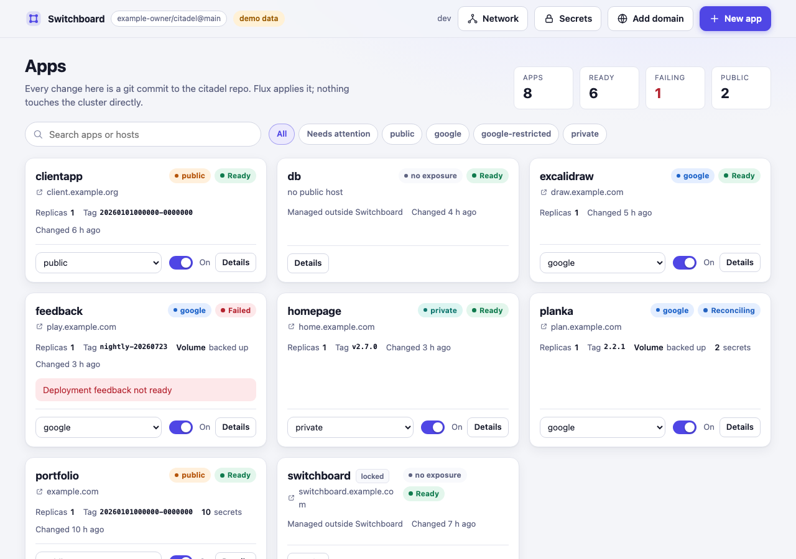
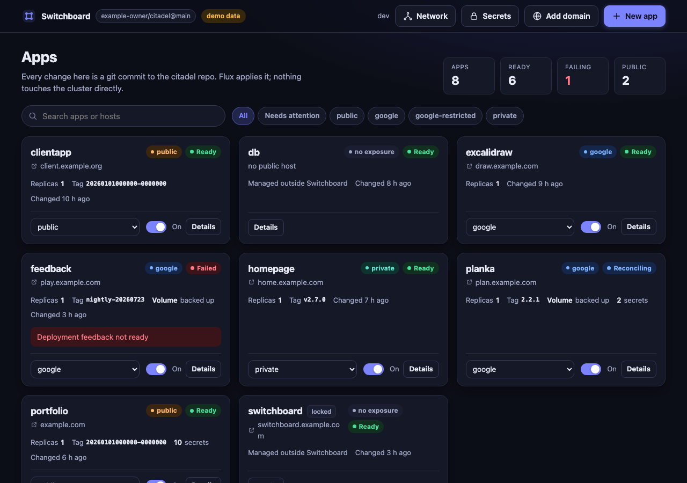
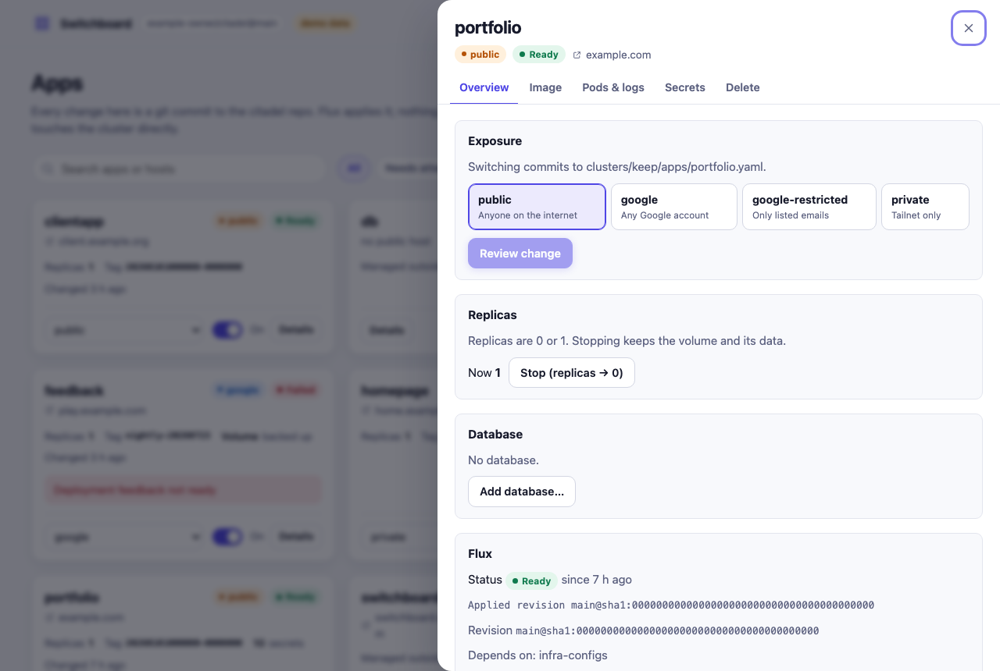
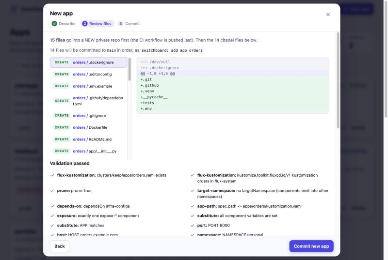
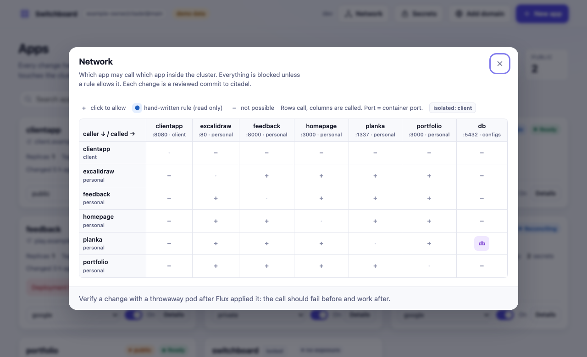
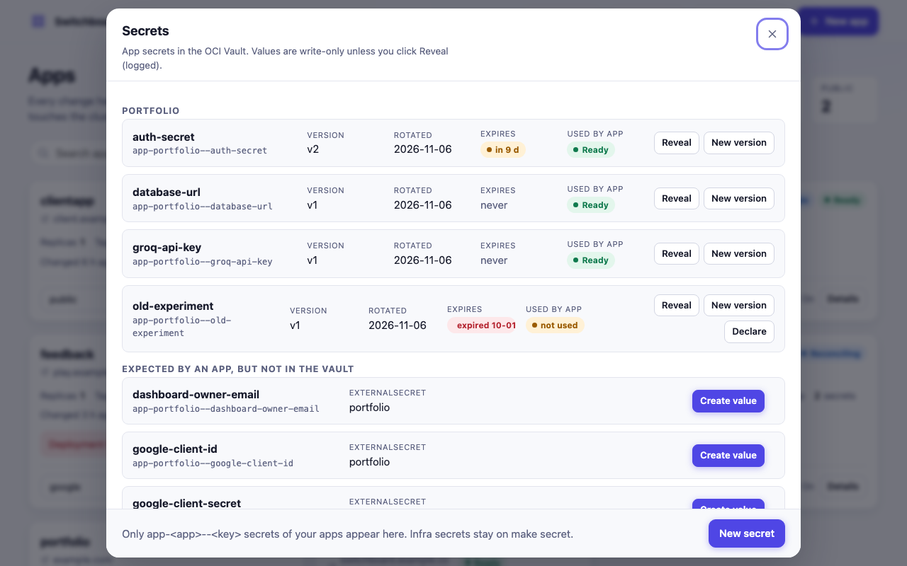
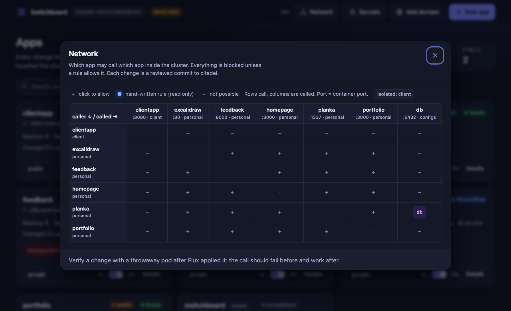
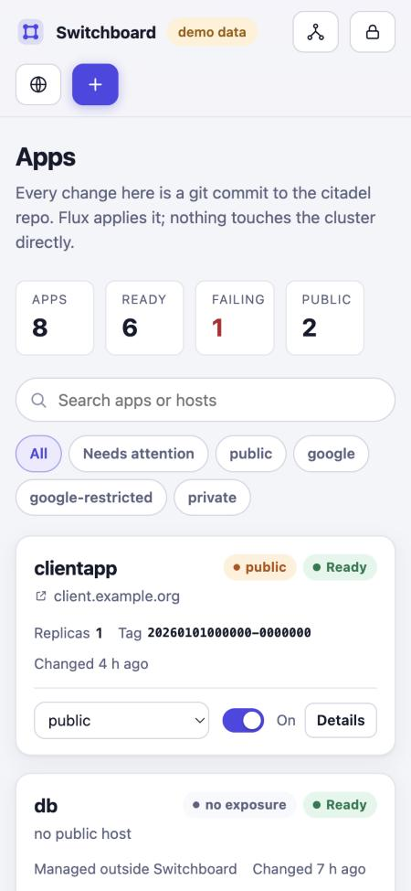
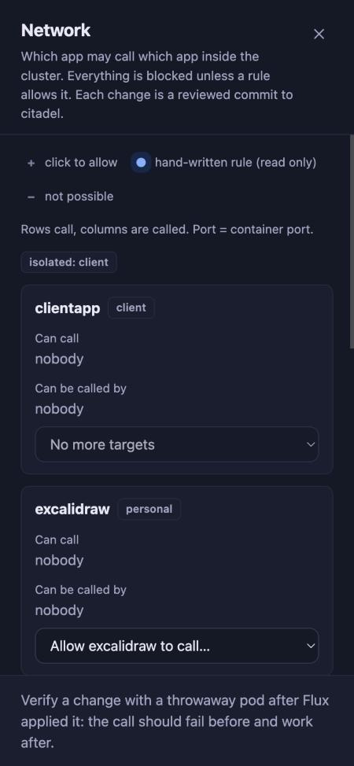

# Switchboard

**An app console for a GitOps repository.** Switchboard is a small Go web app (one static binary, plain HTML/CSS/JS, no build step) that
manages the apps of a Flux/Kubernetes GitOps repo from a browser: create apps (even a whole new project repo with CI), switch who can reach them,
roll back images, manage secrets and database wiring, and control which app may call which. **Every change is a git commit** made through a
GitHub App; Flux applies it. Switchboard never changes workloads in the cluster. Its only cluster write is asking Flux to fetch now; everything
else it reads from the cluster (status, pods, log lines, image scans, ExternalSecret status) is read-only.

> **Companion to [citadel-platform](https://github.com/ravi-ranjan-25/citadel-platform).** citadel is the GitOps platform (Flux, components, apps on a
> small Oracle Cloud Always Free estate); Switchboard is the console that edits that kind of repository. The conventions it expects are the ones citadel uses.

> It is a reference implementation for one specific repository layout (described below), published so you can read it, run it against the
> bundled mock, and adapt it. It is not a drop-in product for arbitrary repos.

<p align="center"></p>

## Screenshots

| | |
|---|---|
|  |  |
|  |  |
|  |  |

Phone width (cards stack, dialogs go full screen):

 

The screenshots show the built-in demo mode with synthetic data (`example.com`).

## Try it in two minutes (no cluster, no GitHub)

```
git clone https://github.com/ravi-ranjan-25/switchboard-console && cd switchboard-console
scripts/dev.sh        # http://127.0.0.1:8080
```

`scripts/dev.sh` starts a mock GitHub API seeded with a small fake GitOps repo (`testdata/seed`), generates a throwaway key, and runs the app with
`DEV_NO_AUTH=1 DEV_NO_CLUSTER=1 DEV_DEMO_CLUSTER=1` and canned cluster data. Nothing real is contacted. Deep links work: `#network`, `#secrets`,
`#domain`, `#new`, `#app:<name>`.

## The repository layout it expects

Switchboard edits a GitOps repo that follows these conventions (see `testdata/seed` for a complete example):

* `clusters/<cluster>/apps/<app>.yaml`: one Flux `Kustomization` per app (`path: ./apps/<app>`, `components:` with one `expose-*` entry,
  `postBuild.substitute` with `APP NAMESPACE PORT HOST`), listed in `clusters/<cluster>/apps/kustomization.yaml`.
* `apps/<app>/`: one Deployment, one Service, optional PVC and ExternalSecret.
* `components/expose-{public,google,google-restricted,private}`, `app-netpol`, `db-client`, `backup-pvc`: Kustomize components that turn
  `postBuild.substitute` values into Ingress, labels and NetworkPolicies.
* Optional: Flux image automation (`image-automation.yaml`), an External Secrets store, a shared CloudNativePG `db` cluster, OpenTofu files for DNS.

The defaults (`APPS_DIR=clusters/keep/apps`, `APP_NAMESPACES=personal,client`, ...) are configurable, but the conventions above are baked into the
validators and generators.

## What it does

| Use case | What happens |
|---|---|
| **Exposure** (v1) | Switch an app between `public`, `google`, `google-restricted` (with an email list) and `private`. Edits only the `expose-*` word in `clusters/keep/apps/<app>.yaml`. |
| **New project** | Pick a stack (Spring Boot, Next.js, React, FastAPI, Django): Switchboard creates a new **private GitHub repo** with a working project, tests, Dockerfile, CI that builds the arm64 image into GHCR, docker-compose and a README, then registers the app in citadel (below). |
| **New app** | A form (name, image, port, exposure, host, optional PVC, optional database client, secret *names*) generates every file, shows them as a diff with a validation report, and commits them. |
| **Replicas** | Start/stop an app (0 or 1) by editing `spec.replicas` in its Deployment. |
| **Image tags and rollback** | Lists the recent tags Flux found for the app's `ImageRepository` and rolls back by committing an older tag on the Deployment image line. Resume hands control back to Flux. |
| **Delete app** | Removes the app's files, Flux Kustomization, registration, image automation and homepage entry. Typed confirmation, extra acknowledgement for PVC data loss. |
| **Pods and logs** | Read-only: pod phase, readiness, restarts, failure reason, and the last log lines (credentials masked). |
| **Secrets** | A Key-Vault-style screen for **app secrets** (`app-<app>--<key>`) in the OCI Vault: list with version, rotation date, expiry and whether the app's ExternalSecret uses and has synced it; create; add a new version; **Reveal** (explicit, 30 s, rate-limited, audited); declare a secret in the app's ExternalSecret (a reviewed citadel commit). Infra secrets (`keep--`, `shared--`, `watchtower--`) are invisible here and stay on `make secret`. |
| **Network** | A matrix of which app may call which app inside the cluster (everything is blocked unless a rule allows it). Click a cell to allow or revoke: a reviewed commit that adds or removes one ingress rule in a generated NetworkPolicy. Hand-written rules and `db-client` show read-only; protected apps and the isolated `client` namespace cannot be connected. |
| **Database** | Give an app its own Postgres database on the shared CNPG cluster: from the New app form ("A new database for this app") or **Add database** on an existing app. One reviewed commit set creates the role, `Database`, password ExternalSecret, nightly dump entry, the generated-secret entries in `bootstrap/`, and rewires the app's `DATABASE_URL` and `db-client`. Idempotent. |
| **Add domain** | Public sites on a new apex domain: edits `var.zones` and `local.tunnel_hosts` in the OpenTofu files, optionally points an app at the domain (plus a `www` redirect). Applies nothing; shows the checklist of manual steps. |

Deleting an app never deletes its GitHub repo or GHCR package.

Protected apps (`PROTECTED_APPS`) can neither be switched loosely, stopped, rolled back nor deleted.

### New app, in detail

Everything follows `apps/README.md` and `components/README.md` of the citadel repo.

* `apps/<app>/kustomization.yaml`, `deployment.yaml`, `service.yaml`, plus `pvc.yaml` and `externalsecret.yaml` if asked.
  Restricted Pod Security: `runAsNonRoot`, `seccompProfile: RuntimeDefault`, `allowPrivilegeEscalation: false`, drop `ALL`,
  requests and limits, readiness and liveness probes, exactly one Deployment and one Service, pinned image.
* `clusters/keep/apps/<app>.yaml`: Flux Kustomization with `dependsOn: infra-configs`, one `expose-*` component, `app-netpol`, and
  (as asked) `db-client` or `backup-pvc` + `pvc-backup` + `restore-if-empty` with `PVC`, `DATA_VOLUME`, `BACKUP_UID`.
* Registered in `clusters/keep/apps/kustomization.yaml` (end of the `# personal` / `# client` section) and in the homepage ConfigMap.
* **Built images** (`ghcr.io/example-owner/<repo>`): the image line carries the Flux marker
  `# {"$imagepolicy": "flux-system:<app>"}` on a placeholder tag, the Deployment pulls with `ghcr-pull`, and an `ImageRepository` +
  `ImagePolicy` (secretRef `ghcr-pull`) are added to `clusters/keep/apps/image-automation.yaml`. Replicas default to 0 until CI has
  pushed a first image. **Public images** must be pinned by tag or digest (never `:latest`).
* Secrets: you list env var **names** (`API_KEY`). The ExternalSecret maps each to the vault name `app-<app>--<kebab>`
  (e.g. `app-notes--api-key`). The preview tells you which names to fill with `make secret`. Plain env vars are accepted but names or values that look like credentials are refused.

Validation runs on the **end state** of the repo (the snapshot with the planned files applied) before anything is committed. It is a Go port of the
checks in `apps/tools/validate-apps.sh` that do not need kustomize or kubeconform (see `check.go`): Flux Kustomization wiring, components resolve to
directories, exactly one `expose-*`, every component variable is set (`flux envsubst --strict` equivalent), one Deployment and one Service, no Namespace or
Secret object, labels and selectors, Service port and targetPort, restricted PSA, resources, probes, pinned image, image automation and `ghcr-pull`, PVC and
backup wiring, ExternalSecret wiring, registration, unique host. It does not replace running `apps/tools/validate-apps.sh` in the citadel repo (that one also does a real
`kustomize build` and schema validation); the commit also does not need it, but running it after is cheap.

### New project: a complete repo plus the citadel entries

"New project" in the New app wizard does the whole job in one preview:

1. **Creates a private repo** `example-owner/<name>` and fills it from a stack template. The preview lists every file of it.
2. **Registers the app in citadel** exactly as a built-image app (above), with port, health path, uid and image fixed by the template so the manifests and the Dockerfile agree.

| Stack | Port / health | Runtime image | Tests in CI |
|---|---|---|---|
| Spring Boot 3, Java 21, Maven | 8080 `/actuator/health` | temurin JRE, uid 1000 | `mvn verify` (MockMvc) |
| Next.js 15 (standalone) | 3000 `/api/health` | node alpine, uid 1000 | `npm test`, `npm run build` |
| React (Vite) + nginx | 8080 `/healthz` | nginx-unprivileged, uid 101 | `npm test`, `npm run build` |
| FastAPI | 8000 `/health` | python slim, uid 1000 | `pytest` |
| Django 5 + gunicorn + whitenoise | 8000 `/healthz` | python slim, uid 1000 | `manage.py test` |

Every generated repo contains: the app source with a health endpoint and a test, a multi-stage non-root `Dockerfile` (with the
`org.opencontainers.image.source` label so the GHCR package stays linked to the private repo), `.github/workflows/build.yml`
(tests, then arm64 image to `ghcr.io/example-owner/<repo>:<UTC>-<sha7>`, PRs only run tests), `.github/dependabot.yml`,
`docker-compose.yml`, `.env.example` (no values), `.gitignore`, `.dockerignore`, `.editorconfig` and a README that explains how the deploy works.
The Kubernetes manifests are deliberately **not** in the app repo: citadel is the single source of truth and Switchboard generated them there.

Stack-specific wiring is added for you: Django declares `DJANGO_SECRET_KEY` as a vault secret name and sets `DJANGO_ALLOWED_HOSTS`, `DJANGO_CSRF_TRUSTED_ORIGINS` and `DJANGO_DEBUG=0`
from the host; its health check is answered before host validation so kubelet probes (which call the pod IP) pass. Spring defaults to the `medium` size, React to `tiny`.

The workflow file is pushed **last**: the repo is filled with one contents-API commit per file, and a workflow that existed from the first push would start a build for each. After the last push the first
build runs; its image tag is picked up by Flux image automation, and the app (which starts at replicas 0) is switched on in the console. If creating the repo or pushing a file fails, nothing is committed to citadel; a repo that was already created is left as it is and the message says so.
The templates live in `templates/` (embedded, `[[ ]]` delimiters so GitHub Actions `${{ }}` survives). `go test` renders every stack and checks that the YAML, JSON and XML parse and that Python compiles.

### Database: what the commits contain

For app `X` (database and role name `X`, dashes become underscores), in this order, each one skipped if already present:

1. `bootstrap/secrets.catalog.yaml` gets `X_db_password` in the generated list, and `bootstrap/vault/mapping.yaml` gets `keep--X-db-password` (generated), aligned with their neighbours.
2. `apps/db/externalsecret.yaml`: ExternalSecret `db-X` (basic-auth Secret for the role, `cnpg.io/reload`), from that vault key.
3. `apps/db/cluster.yaml`: managed role `X` with `passwordSecret: db-X`; `apps/db/databases.yaml`: `Database` `X` (`databaseReclaimPolicy: retain`); `apps/db/dump-cronjob.yaml`: `X` added to the nightly dump loop.
4. `apps/X/externalsecret.yaml`: a template (`engineVersion: v2`, `mergePolicy: Merge`) builds `DATABASE_URL=postgresql://X:{{ .db_password | urlquery }}@db-rw.configs.svc.cluster.local:5432/X` from the SAME generated password (a hand-entered `app-X--database-url` entry is replaced). For an existing app this needs exactly one ExternalSecret.
5. `clusters/keep/apps/X.yaml`: the `db-client` component and `dependsOn: db`. For an existing app this commit comes last.

**Switchboard cannot create the password.** After the commits, in your shell: `make secrets` (generates the new value) and `make vault-push`. Until then the new role's Secret and the app's `DATABASE_URL` show as not Ready. Deleting an app keeps its database (retain). `bootstrap/*.yaml` files are read by Switchboard (never the encrypted `*.sops.yaml`).

### Network: how an allowed call is stored

Each namespace is default-deny for ingress and every app opens only its own port to Traefik and the tailnet (`components/app-netpol`), so one app cannot call another today. Allowing `A -> B` writes
**one generated NetworkPolicy per destination app**, `apps/<B>/netpol-from-apps.yaml`, with one ingress rule per allowed caller (namespace + `citadel.dev/app` label, TCP on B's **container** port: NetworkPolicy matches the pod port, not the Service port, which differs for e.g. ClientApp).
The file is listed in the app's kustomization **last**, so only that commit makes Flux apply it; revoking the last caller unlists it first and then deletes the file. NetworkPolicies are additive, so this only widens access and never narrows what other policies allow.
Rules: both apps must be standard and not protected; no self edges; apps in `NETWORK_ISOLATED_NAMESPACES` (default `client`, i.e. ClientApp) cannot be connected to apps of other namespaces; a caller that uses `egress-restricted` in another namespace is refused (it would also need an egress rule, not supported yet).
The screen reads the repo only (no cluster access, no extra RBAC); it shows what git declares, not live enforcement. Verify a change with a throwaway pod after Flux applied it: the call should fail before and work after. Not done yet: live drift view and the Tailscale host matrix (`docs/PLAN-network-console.md`, phases 3 to 5).

### Image rollback and the Flux marker

Flux image automation always moves a marked image line to the newest tag the `ImagePolicy` selects. A rollback that kept the marker would be undone within
`ImageUpdateAutomation.interval`. So **rollback commits the older tag and replaces the marker comment** by `# pinned by switchboard (rollback); ...`. The Image tab then says
"pinned", and **Resume auto-update** restores the exact `# {"$imagepolicy": "flux-system:<app>"}` marker. (Assumption to verify once on the cluster: Flux ignores an image line without the JSON marker. That is how setters work, but test it on a throwaway app.)

### Add domain, in detail

Scope: **public** sites on a new apex domain. Private, tailnet-only and Google-gated hosts are refused on a new domain because the wildcard certificate, the private DNS
and the oauth2-proxy cookie are scoped to `.example.com` only (the UI says so).

The form takes the apex domain, "include www" and optionally the app to serve it. The commits are, in this order:

1. `infra/tofu/variables.tf`: the domain is appended to the `zones` default list (single- or multi-line, formatting kept).
2. `infra/tofu/cloudflare.tf`: `"<domain>"` (and `"www.<domain>"`) are added to `local.tunnel_hosts`; the `=` column is re-aligned as `tofu fmt` does.
3. With an app and www: `apps/<app>/www-redirect.yaml` (same pattern as `apps/clientapp/www-redirect.yaml`) and a line in the app's kustomization.
4. With an app: `HOST` in `clusters/keep/apps/<app>.yaml` is set to the domain and the exposure is switched to `public` if it was not. The old host stops working when Flux applies this.

Syntax is validated, duplicates (in `zones`, `tunnel_hosts`, any app `HOST`) are refused, and the dialog shows a checklist, which you run yourself:

1. In Cloudflare add the site `<domain>` and change the nameservers at the registrar. Wait until it shows **Active**.
2. `make tofu-apply STAGE=3 TOFU_ARGS="-var phase2=true" CONFIRM=yes`
3. Wait for Flux.

Switchboard **never applies** anything of this.

### Multi-file changes

The GitHub contents API commits one file per call, so a new app is several commits, ordered so that **every intermediate state is harmless**:
the app directory first (nothing references it), then its Flux Kustomization (not yet registered), then image automation and homepage, and **the registration in
`clusters/keep/apps/kustomization.yaml` last**, the commit that makes Flux deploy it. Deleting reverses this: the unregistration goes first. Shared files are re-read right before
each write and the edit is re-applied to the fresh text if they moved on (up to 3 tries on a 409). If a commit fails the job stops and reports exactly how many landed; nothing is rolled
back automatically (the safe-to-leave order means a half-created app is just inert files). The commit message is `switchboard: add app <name> [3/9]`.

A preview returns a hash of exactly what it shows. The commit request must carry it, and the server re-plans against a fresh read of the repo; if anything differs (someone pushed,
the form changed) it answers 409 and asks you to preview again.

## Security model

* **Who can use it.** It is meant to run behind `expose-google-restricted`. Traefik's forwardAuth calls oauth2-proxy, which answers with `X-Auth-Request-Email`; Traefik copies it onto the request,
  replacing any client-supplied value. Switchboard checks it against `ALLOWED_EMAILS` (case-insensitive) on every request except `/healthz` and refuses to start without the list
  (`DEV_NO_AUTH=1` is for local development only and logged as a warning). The header is trustworthy only because `app-netpol` limits who can reach the pod. The email is the `user` in the audit log.
* **Browser.** Strict CSP (`default-src 'none'; script-src 'self'; style-src 'self'; connect-src 'self'; img-src 'self' data:; font-src 'self'; frame-ancestors 'none'`), no inline script or style, no CDN, no third-party request.
  Everything is embedded with `go:embed`. All dynamic text is set with `textContent`, never `innerHTML`.
  POSTs need a double-submit CSRF token (HttpOnly SameSite=Strict cookie + `X-CSRF-Token`), JSON content type only, unknown fields refused, `Origin` must match `Host`.
* **Creating repos.** A GitHub App installation cannot create repos under a personal account, so *New project* uses a separate **fine-grained PAT** (Administration, Contents, Workflows: write, Metadata: read on your repos).
  This is the most powerful credential in the system: Administration write could also delete repos. Mitigations: it lives only in the OCI Vault, is mounted read-only as a file in the Switchboard pod (`GITHUB_REPO_TOKEN_PATH`), is never put in argv, env or logs,
  is used only for creating the one new private repo and pushing its initial files (Switchboard has no code path that deletes or edits other repos), the secret is optional (without it the option is greyed out), and you should give it the shortest expiry you can live with.
* **Secrets screen.** App secrets only: names must be `app-<app>--<key>` for an app that exists in citadel, is a standard app and is not protected; infra names are refused by the server and (should be) by the IAM policy.
  Values travel only in POST bodies over TLS to the vault: not stored in git (a test asserts no value reaches the mock repo), not cached, not logged (a test asserts the audit log holds user, secret name and version only), and never returned except by **Reveal**, which is
  explicit per secret, capped at 10 per minute, shown for 30 seconds then wiped from the page, and audit-logged. The write path is OCI Vault through keep's **instance principal**: no API key exists, but the grant is host-wide (see `deploy/README.md`).
  Updating creates a new vault version; External Secrets refreshes within an hour and pods read secrets at start, so the app needs a restart to see it. The UI says so. A secret can be created without being declared; "not used" marks it, and a name an ExternalSecret expects but the vault lacks is listed as missing.
* **What it can change.** Besides that, only files in the citadel repo, through a GitHub App installed on that repo with **Contents: read & write** and **Metadata: read** (no other repo, no Actions, no PRs, no admin).
  The new-app form never accepts secret values: secret names only, credential-looking env names and values refused, `Secret` objects in git fail validation.
* **What it can read in the cluster** (`deploy/rbac.yaml`, all namespaced Roles, no ClusterRole): Flux Kustomizations (get/list/watch), `imagerepositories` and `imagepolicies` (get/list),
  pods and `pods/log` (get/list/get) and `externalsecrets` (get/list) in `personal` and `client`. **Its only write:** `patch` on `gitrepositories/flux-system` by resource name to request a fetch. It cannot read Secrets, exec, or delete anything.
* **Logs.** The last lines of an app's pod are shown to the allow-listed owners. Obvious credentials (`password=`, `token:`, `Authorization: Bearer`) are masked, but logs can still contain personal data. A pod can only be read
  if it belongs to the app (listed by the `citadel.dev/app` label) and only in the configured namespaces.
* **Guard rails.** `PROTECTED_APPS` (default `switchboard<=google-restricted,auth=public,oauth2-proxy=public,headlamp<=google-restricted`) pins exposure rules and also forbids stop, rollback and delete. Only standard apps (`./apps/<dir>` with one Deployment, one Service and an
  `expose-*` component) can be stopped, rolled back or deleted. Delete refuses apps that others `dependsOn` or that share a directory. One change per app at a time (in-memory lock, so a single replica).
* **Audit.** Every operation writes one JSON log line (`msg":"op"`: user, op, app, result, commit) and the commit history of the citadel repo is the permanent record (`citadel-switchboard[bot]`).
* **Known limits.** Commits are not "Verified" (explicit committer set; drop the committer fields in `github.go` for verified App commits). Replicas are 0 or 1 only. Delete prunes PVC data; the restic backups in the object stores stay.

## Configuration (env)

| Var | Default | Notes |
|---|---|---|
| `GITHUB_APP_ID`, `GITHUB_INSTALLATION_ID` | required | |
| `GITHUB_PRIVATE_KEY` or `GITHUB_PRIVATE_KEY_PATH` | one required | the Deployment mounts the key as a file |
| `REPO` / `BRANCH` | **required** `owner/name` / `main` | the GitOps repository |
| `APPS_DIR` | `clusters/keep/apps` | |
| `TOFU_DIR` | `infra/tofu` | where `variables.tf` and `cloudflare.tf` live (Add domain) |
| `APP_NAMESPACES` | `personal,client` | namespaces the new-app form and the pod/log/secret views may use |
| `IMAGE_PREFIX` | `ghcr.io/<owner of REPO>/` | prefix of "built by my CI" images |
| `OCI_VAULT_ID`, `OCI_COMPARTMENT_ID`, `OCI_KEY_ID` | empty | enable the Secrets screen (OCI Vault through instance principal; the key is the vault's master key) |
| `GITHUB_REPO_TOKEN_PATH` or `GITHUB_REPO_TOKEN` | empty | fine-grained PAT for *New project*; empty disables it |
| `REPO_OWNER` | owner of `REPO` | account the new repos are created under |
| `PRIMARY_DOMAIN` | `example.com` | the domain whose wildcard certificate, private DNS and sign-in cookie the private/Google modes rely on (Add domain refuses it and its subdomains) |
| `NETWORK_ISOLATED_NAMESPACES` | `client` | namespaces whose apps cannot be connected to other namespaces from the Network tab |
| `ALLOWED_EMAILS` | **required** | comma separated |
| `DEV_NO_AUTH` | empty | `1` disables the identity check (local only) |
| `PROTECTED_APPS` | see above | `app=mode` pins, `app<=mode` caps; also blocks stop/rollback/delete |
| `LISTEN` | `:8080` | |
| `FLUX_NAMESPACE`, `GITREPOSITORY_NAME` | `flux-system` | |
| `COMMITTER_EMAIL` | `citadel-switchboard[bot]@users.noreply.github.com` | |
| `GITHUB_API_URL` | empty | override (tests, mock) |
| `DEV_NO_CLUSTER` | empty | `1` skips in-cluster config; pills show Unknown |
| `DEV_DEMO_CLUSTER` | empty | with `DEV_NO_CLUSTER=1`: canned fake pods, tags, secrets and statuses; the page shows a "demo data" chip |

## Develop

```
go vet ./... && go test -race ./...
scripts/dev.sh            # mock GitHub (testdata/seed) + the app on http://127.0.0.1:8080, demo cluster data
DEMO=0 scripts/dev.sh     # same, but an empty cluster (no demo vault either)
```

`scripts/dev.sh` generates a throwaway RSA key in a temp dir, starts `cmd/mockgithub` (an in-memory fake of the GitHub endpoints used here, seeded from `testdata/seed`, a copy of
the relevant citadel files) and runs the app with `DEV_NO_AUTH=1 DEV_NO_CLUSTER=1`. Nothing real is contacted. Layout:

```
main.go config.go server.go ops.go       HTTP, config, the plan/apply endpoints
model.go scaffold.go domain.go tofu.go   repo model, new-app generator, Add domain, HCL splices
edits.go yamledit.go                      targeted line edits (verified by re-parsing)
check.go validate.go diff.go plan.go      validation, input rules, diff, ordered commit plans
github.go cluster.go demo.go              GitHub (trees, blobs, contents), read-only cluster, demo data
network.go                                Network tab: edges from NetworkPolicies, allow/revoke plans
source.go repocreate.go templates/        project templates (5 stacks), repo creation with the PAT
web/                                      index.html, app.css, app.js, favicon.svg (embedded)
internal/mockgh, cmd/mockgithub           GitHub fake for tests and local runs
testdata/seed/                            citadel files used as the fake repo
deploy/                                   manifests for the citadel repo (see deploy/README.md)
```

## Deploy

See [deploy/README.md](deploy/README.md): CI to GHCR, the `ghcr-pull` secret, the manifests to copy into the citadel repo, the cutover from v1 and the GitHub App permissions.
